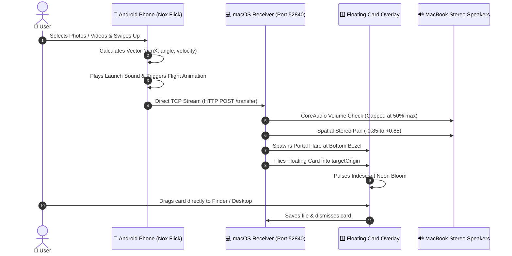

<div align="center">

# ⚡ NOX FLICK
### *Kinetic Spatial Gesture & Multi-File Transfer for Android & macOS*

<p align="center">
  
</p>

<p align="center">
  <b>Beam photos, videos, documents, and links from Android to Mac with real physical throw physics.</b><br>
  <i>Watch them fly off your phone screen and catch on your Mac display exactly where you threw them.</i>
</p>

<!-- Color Badges -->
<p align="center">
  <a href="#"></a>
  <a href="#"></a>
  <a href="#"></a>
  <a href="#"></a>
</p>

<p align="center">
  <a href="#"></a>
  <a href="#"></a>
  <a href="#"></a>
  <a href="#"></a>
  <a href="#"></a>
</p>

---

</div>

## 🌈 Why Nox Flick?

Traditional cross-platform file transfers are either clunky (Bluetooth pairing menus), slow (cloud sync relays), or require accounts. 

**Nox Flick** merges high-performance local network streaming with **physical gesture dynamics and spatial audio**:

* 🎯 **Spatial Throw Physics**: Aim left, center, or right $\rightarrow$ the card catches at that exact physical position on your Mac.
* 📚 **Multi-File Batch Sending**: Select multiple photos and videos at once; they fly across and fan out across your Mac like a deck of cards.
* 🔮 **Iridescent Neon Glow**: VisionOS-grade frosted glass floating cards with a dynamic multi-color perimeter glow.
* 🔊 **Spatial Stereo Chime**: Acoustic arrival chime that physically pans across your MacBook speakers based on throw angle, capped at 50% max volume.
* ✕ **Zero-Save Dismiss Button**: Instant `✕` button to discard files immediately without saving to disk.
* 🖱️ **Drag-and-Drop to Finder**: Drag any card preview straight into Finder, Desktop, Slack, Mail, or Photoshop.

---

## ✨ Feature Deep Dive

### 📚 1. Multi-File Batch Transfer (Photos & Videos)
Send single files or batch-select 10+ items at once:
* Multi-select photos, videos, PDFs, and downloads directly from the in-app picker or the system Share Sheet.
* Arriving files cascade sequentially onto your Mac display with automatic spatial fanning so cards never overlap illegibly.

### 🎯 2. True Kinetic Aiming & Throw Physics
* **Horizontal Aiming (`aimX`)**: Swipe diagonally up-left $\rightarrow$ card catches on the **left side** of your screen. Swipe right $\rightarrow$ card catches on the **right side**.
* **Throw Velocity**: Soft flicks settle low near the Dock; high-energy throws soar towards the menu bar.
* **Vector Rotation**: Drag trajectory angle is calculated in real time ($\pm 30^\circ$) and preserved when landing on macOS.
* **Wrist Snap Mode**: Built-in accelerometer fusion lets you snap your phone wrist towards your Mac to launch.

### 🔮 3. Apple-Grade Iridescent Neon Floating Card
* **Live Frosted Glass**: Native macOS `NSVisualEffectView` HUD backdrop with deep obsidian tint.
* **Iridescent Neon Rim**: Crisp 2.0 pt gradient border cycling through Electric Cyan, Royal Azure, Neon Violet, and Magenta.
* **Transient Portal Flare**: Atmospheric bottom-edge bloom appears at the exact entry coordinate as the card flies up.
* **Click-Through Padding**: Transparent aura around tilted cards is completely click-through—underlying windows remain interactive.

### 🔊 4. Spatial Acoustic Sound with 50% Safety Volume Cap
* **Spatial Stereo Panning**: Audio chime physically shifts between MacBook speakers to match where the card entered (`-0.85` to `+0.85`).
* **50% Max Volume Limiter**: Reads macOS master output volume via CoreAudio. If your Mac is at 100%, the chime is capped at 50% loudness to protect your ears. If your Mac is at 20%, it respects that lower volume.

### ⚡ 5. Lightweight 24/7 Menu Daemon
* **0.0% Idle CPU**: Event-driven Apple `Network.framework` socket listener sleeping in kernel `kqueue`.
* **Dock-Free Accessory**: Runs quietly in the macOS menu bar (`sparkles` icon) with a native Control Panel window.
* **Menu Shortcuts**:
  * `Option + D` $\rightarrow$ Dismiss all floating cards
  * `Command + S` $\rightarrow$ Toggle server On / Off
  * `Command + P` $\rightarrow$ Open Control Panel

---

## 🏗️ Architecture & Data Flow



---

## 🚀 Quick Start Guide

### Step 1: Launch on Mac
1. Open **`NoxFlick.app`** from `/Applications` or [`Desktop/Dark Folder/09_NoxFlick`](#).
2. The sparkle icon appears in your menu bar and the control panel opens:
   * **Receiver Status**: `ONLINE (Port 52840)`
   * **Bonjour Advertising**: `_flick._tcp.`

> [!TIP]
> You can switch the receiver ON/OFF at any time using the toggle switch in the Control Panel or from the menu bar item.

### Step 2: Open on Android
1. Install **`NoxFlick.apk`**:
   ```bash
   adb install -r -t prebuilt/NoxFlick-Android.apk
   ```
2. Open the app. Nearby Macs on the same Wi-Fi network are auto-discovered within seconds.

### Step 3: Select, Flick & Catch!
1. Tap **Photos** (select multiple photos or videos) or **Files** (select documents/PDFs).
2. Touch the card and **swipe up toward your MacBook display** (or flick your wrist).
3. The cards will soar off your phone screen and cascade across your Mac display!
4. **Drag to Finder** to save, or click **`✕`** on any card to dismiss without saving.

---

## 📊 Technical Comparison

| Feature | AirDrop | Quick Share | Nox Flick ⚡ |
| :--- | :---: | :---: | :---: |
| **Android $\leftrightarrow$ macOS Native** | ❌ (Apple Only) | ❌ (Windows/Android Only) | ✅ **Full Native Support** |
| **Physical Spatial Aiming** | ❌ | ❌ | ✅ **Real Throw Physics** |
| **Multi-File Batch Transfer** | ✅ | ✅ | ✅ **Sequential Fanned Cascade** |
| **Spatial Stereo Audio** | ❌ | ❌ | ✅ **Panned Arrival Chime** |
| **Interactive Floating Overlay** | ❌ | ❌ | ✅ **VisionOS Glass HUD** |
| **Zero Cloud / LAN Only** | ✅ | ⚠️ | ✅ **Direct Socket Stream** |
| **Idle CPU Usage** | Variable | Variable | ✅ **0.0% Idle** |

---

## ⌨️ Keyboard Shortcuts (macOS)

| Shortcut | Action | Description |
| :--- | :--- | :--- |
| <kbd>Option</kbd> + <kbd>D</kbd> | **Dismiss All Cards** | Instantly closes all active floating cards |
| <kbd>Command</kbd> + <kbd>S</kbd> | **Toggle Receiver** | Switches the background receiver ON / OFF |
| <kbd>Command</kbd> + <kbd>P</kbd> | **Control Panel** | Toggles the frosted settings & status window |
| <kbd>Command</kbd> + <kbd>O</kbd> | **Open Downloads** | Reveals the `Nox Flick Received` folder in Finder |
| <kbd>✕ Click</kbd> | **Close Single Card** | Wipes the temporary file and closes that card |

---

## 🛠️ Building from Source

### macOS AppKit Receiver
* Requirements: macOS 14.0+, Xcode Command Line Tools (`swift --version` 6.0+)
```bash
cd FlikMac
./build_mac_app.sh
open /Applications/NoxFlick.app
```

### Android Sender
* Requirements: Android Studio / Gradle 8.9+, JDK 17+, Android SDK 34
```bash
cd FlikAndroid
./gradlew assembleDebug
adb install -r app/build/outputs/apk/debug/app-debug.apk
```

---

## 📄 License
This project is open-source under the [MIT License](LICENSE).

<div align="center">
  <sub>Designed & Developed by Naveen • Crafted for speed, physical delight, and seamless continuity.</sub>
</div>
