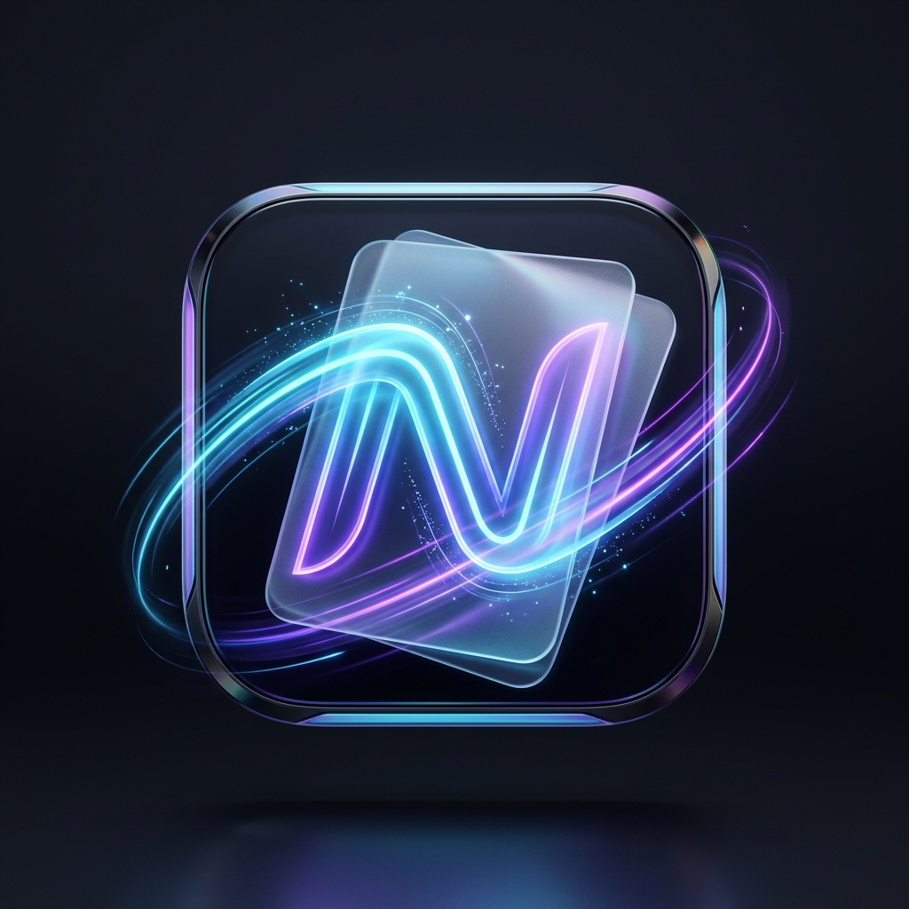

<div align="center">

# 🚀 NOX FLICK
### *Kinetic Spatial Gesture File Transfer between Android & Apple Silicon Mac*

<p align="center">
  
</p>

[](#)
[-3DDC84?style=for-the-badge&logo=android&logoColor=white)](#)
[](#)
[](#)
[](#)
[](#)

---

</div>

## 🌌 Overview

**Nox Flick** recreates the viral, futuristic "flick-to-share" concept from scratch with real native engineering. Flick a photo, document, video, or link from your Android phone toward your MacBook—the card flies off your phone screen and instantly **catches on your Mac display at the exact spatial angle and location where you threw it**.

No cloud servers. No Bluetooth pairing friction. No relay latency. Pure direct local Wi-Fi streaming.

---

## ✨ Features

### 🎯 1. Real Spatial Throw Physics
* **Horizontal Aiming (`aimX`)**: Swipe diagonally up-left $\rightarrow$ card catches on the **left side** of your Mac display. Swipe right $\rightarrow$ card catches on the **right side**. Swipe straight up $\rightarrow$ card lands in the **center**.
* **Vertical Velocity Mapping**: Gentle flicks land low near your macOS Dock; fast, energetic throws land high near the menu bar.
* **Vector Tilt & Gyro Rotation**: Drag direction is computed in real time using $\arctan(\Delta X, -\Delta Y)$, tilting the landed card to match your throw angle (up to $\pm 35^\circ$).
* **Wrist-Snap Motion Detection**: Built-in accelerometer & gyroscope fusion lets you physically snap your wrist toward your laptop to send.

### 🪟 2. Native macOS Frosted Glass Floating Card
* **System Overlay**: Sits at `.floating` level with `.canJoinAllSpaces` and `.fullScreenAuxiliary`—floats gracefully above all apps, full-screen spaces, and games.
* **Direct Drag & Drop (`NSDraggingSource`)**: Drag the preview image straight into **Finder**, **Desktop**, **WhatsApp**, **Slack**, or **Mail**. Releasing the drag automatically dismisses the card.
* **Instant Dismiss (`✕`)**: Need to discard a file without saving? Click the glass close button to instantly wipe the temporary file and close the card.
* **Click-Through Transparency**: All empty space around the rotated card is completely click-through; underlying apps remain 100% interactive.

### ⚡ 3. Lightweight 24/7 Menu Daemon
* **Zero Dock Clutter**: Operates as a pure macOS accessory (`LSUIElement = true`) living exclusively in your top menu bar with status controls.
* **0.0% Idle CPU**: Pure event-driven Apple `Network.framework` socket server. No polling loops.
* **Auto-Healing Connection**: Automatically recovers and rebinds Bonjour advertising if your MacBook sleeps, wakes, or switches Wi-Fi networks.

### 📱 4. Android System Share Sheet Integration
* Select any photo, video, PDF, or text in Google Photos, Files, Gallery, or Chrome $\rightarrow$ tap **Share** $\rightarrow$ choose **"Nox Flick this"** to beam it directly to your laptop.

---

## 🏗️ Architecture

```text
┌──────────────────────────────────────┐             ┌──────────────────────────────────────────────┐
│           ANDROID SENDER             │             │           macOS RECEIVER (Nox Flick)         │
│                                      │             │                                              │
│  [ Touch Gesture ]   [ Wrist Snap ]  │             │   [ Menu Bar Daemon ] (0.0% CPU / ~50MB RAM) │
│   VelocityTracker     Gyro + Accel   │             │                                              │
│         │                  │         │             │   NWListener (_flick._tcp. / Port 52840)     │
│         └────────┬─────────┘         │             │         ▲                                    │
│                  ▼                   │             │         │                                    │
│     Compute Throw Trajectory         │             │         │                                    │
│     - aimX (-1.0 to +1.0)            │             │         │                                    │
│     - flickAngle (-35° to +35°)      │             │         │                                    │
│     - velocity (0.8 to 2.5)          │             │         │                                    │
│                  │                   │             │         │                                    │
│                  │ Bonjour Discovery │             │         │                                    │
│                  ├───────────────────┼─────────────┼─────────┘                                    │
│                  │ (NsdManager)      │  Local LAN  │                                              │
│                  ▼                   │             │                                              │
│        Direct HTTP Binary Stream     │             │                                              │
│       ┌──────────────────────┐       │  Zero Cloud │                                              │
│       │ Content-Length       │═══════╪════════════►│  Receive Binary Chunk                        │
│       │ X-Flick-Position-X   │       │ 300-800Mbps │  AudioServicesPlaySystemSound(Pop)           │
│       │ X-Flick-Angle        │       │             │         │                                    │
│       │ X-Flick-Velocity     │       │             │         ▼                                    │
│       └──────────────────────┘       │             │  FloatingCardWindow (AppKit NSPanel)         │
│                                      │             │  - Fly-in trajectory from bottom edge        │
│                                      │             │  - Landing at (targetX, targetY)             │
│                                      │             │  - Rotation: flickAngle                      │
│                                      │             │  - Native Pasteboard Drag to Finder          │
└──────────────────────────────────────┘             └──────────────────────────────────────────────┘
```

---

## 🚀 Quick Start Guide

### Step 1: Launch on Mac
1. Open **`Nox Flick.app`** (or run `./FlikMac/build_mac_app.sh`).
2. A subtle sparkle icon **`✨`** appears in your top menu bar.
3. Nox Flick is now armed and listening for incoming files.

### Step 2: Install on Android
1. Install **`prebuilt/NoxFlick-Android.apk`** on your Android device:
   ```bash
   adb install -r -t prebuilt/NoxFlick-Android.apk
   ```
2. Open **Nox Flick**. Your MacBook will be discovered automatically within seconds!

### Step 3: Flick & Land!
* **Touch Flick**: Tap **Photos** or **Files**, select a file, hold the preview card, and swipe up towards your MacBook screen.
* **Wrist Flick**: Hold your phone upright and snap your wrist forward toward your Mac display.
* **Save**: Drag the preview card into Finder, or click **`✕`** to dismiss without saving.

---

## 📊 Technical Specifications

| Parameter | Specification | Details |
| :--- | :--- | :--- |
| **Networking** | Apple `Network.framework` & `HttpURLConnection` | Direct TCP socket streaming, zero intermediate cloud |
| **Discovery** | mDNS / DNS-SD (`_flick._tcp.`) | Auto-discovery via Android `NsdManager` & macOS Bonjour |
| **Port** | `52840` (Dynamic fallback) | High-port local socket with auto-retry |
| **Throughput** | 300 – 800 Mbps | Unbuffered fixed-length binary chunk streaming |
| **Mac RAM / CPU** | ~50 MB / 0.0% Idle | Pure GCD event loop, sleeping in kernel `kqueue` |
| **Security** | Local LAN Only | Bound to local network interface; zero external telemetry |

---

## 🛠️ Building from Source

### macOS Receiver
* **Requirements**: macOS 14.0+, Xcode Command Line Tools (`swift --version` 6.0+)
```bash
cd FlikMac
./build_mac_app.sh
open "Nox Flick.app"
```

### Android Sender
* **Requirements**: Android Studio / Gradle 8.9+, JDK 17+, Android SDK 34
```bash
cd FlikAndroid
./gradlew assembleDebug
adb install -r app/build/outputs/apk/debug/app-debug.apk
```

---

## 📄 License
This project is open-source under the [MIT License](LICENSE).

<div align="center">
  <sub>Engineered by Naveen • Crafted for speed, aesthetics, and pure continuity.</sub>
</div>
